# 🧠 Unconscious Mind — priming experiment

Hi! 👋 This is the app for our experiment. It shows people very fast hidden pictures and then asks them
to pick between two pictures. We want to know if the hidden pictures change what they pick.

**You don't need to know anything about computers.** Just follow the steps one by one, in order.
Every step has a picture or a box to copy. That's it.

> 💻 This guide is for **Mac** laptops.
> ⏱️ The first time takes about **15 minutes** (most of it is waiting for Git to install).
> After that, starting the app takes **10 seconds**.

---

## 📋 Contents

1. [Install Google Chrome](#step-1--install-google-chrome)
2. [Open the Terminal](#step-2--open-the-terminal)
3. [Install Git](#step-3--install-git)
4. [Download the app (clone it)](#step-4--download-the-app-clone-it)
5. [Open the app](#step-5--open-the-app)
6. [Get the laptop ready](#step-6--get-the-laptop-ready-before-every-session)
7. [Run a participant](#step-7--run-a-participant)
8. [Save and send the results](#step-8--save-and-send-the-results)
9. [Look at the results dashboard](#step-9--look-at-the-results-dashboard)
10. [Get the newest version](#step-10--get-the-newest-version-later)
11. [Something went wrong? 🆘](#-something-went-wrong)

---

## Step 1 — Install Google Chrome

The app only works properly in **Google Chrome** (not Safari).

1. Go to 👉 **<https://www.google.com/chrome/>**
2. Click **Download Chrome**, open the file, and drag Chrome into **Applications**.

Already have Chrome? Great, skip this step. ✅

---

## Step 2 — Open the Terminal

The Terminal is an app where you type commands. Don't be scared, you only need to copy and paste. 🙂

1. Press **⌘ Command + Space** on the keyboard (a search bar appears).
2. Type **`Terminal`**
3. Press **Enter** ⏎

A window with text appears. That's the Terminal. Keep it open.

> 💡 **How to copy a command from this page:** every grey box has a small **copy button** ⧉ in the top-right corner
> on GitHub. Click it, then click inside the Terminal and press **⌘ Command + V**, then **Enter** ⏎.

---

## Step 3 — Install Git

Git is the tool that downloads our app from GitHub.

**3.1** Paste this into the Terminal and press **Enter**:

```bash
git --version
```

**3.2** One of two things happens:

- ✅ **You see something like `git version 2.39.5`** → Git is already installed. Go to Step 4.
- 📦 **A window pops up** saying *"The git command requires the command line developer tools. Would you like to install the tools now?"*
  1. Click **Install**
  2. Click **Agree**
  3. Wait (5–15 minutes ☕). Don't close the laptop.
  4. When it says *"The software was installed"*, click **Done**.
  5. Paste `git --version` again and press **Enter**. Now you should see `git version …` ✅

> 🙋 No pop-up and no version? Download Git from 👉 **<https://git-scm.com/download/mac>** and install it like any other app.

---

## Step 4 — Download the app (clone it)

"Cloning" just means **downloading a copy** of the app onto your laptop. We'll put it on your **Desktop**.

**4.1** Go to the Desktop. Paste and press **Enter**:

```bash
cd ~/Desktop
```

**4.2** Download the app. Paste and press **Enter**:

```bash
git clone https://github.com/Thevaultboy11/unconscious-mind-experiment-temp.git
```

You'll see some lines like `Receiving objects: 100%`. Wait until it finishes (about a minute — the pictures are big).

**4.3** Look at your Desktop: there is now a folder called **`unconscious-mind-experiment-temp`** 📁. That's the app!

> 🔐 **It asks for a username and password?** That means the project is private. Ask the group leader to add you on GitHub,
> or use the **plan B** below.
>
> 🅱️ **Plan B (no Git at all):** open 👉 **<https://github.com/Thevaultboy11/unconscious-mind-experiment-temp>**, click the green **`<> Code`** button → **Download ZIP**.
> Double-click the ZIP in your Downloads to unzip it, and drag the folder to your Desktop. Then continue with Step 5.

---

## Step 5 — Open the app

**Easiest way — paste these two lines into the Terminal (Enter after each):**

```bash
cd ~/Desktop/unconscious-mind-experiment-temp
```

```bash
open -a "Google Chrome" index.html
```

**Or with the mouse:**

1. Open the **`unconscious-mind-experiment-temp`** folder on your Desktop.
2. **Right-click** (or Control + click) on **`index.html`**
3. Choose **Open With → Google Chrome**

You should see this screen 👇

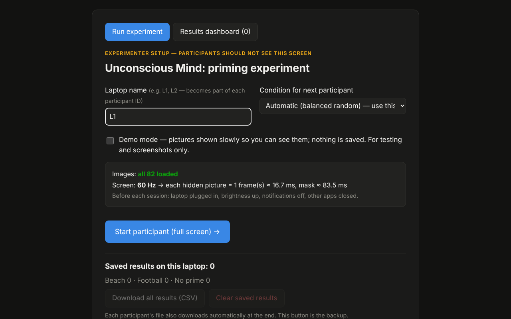

Check two things in the grey box:

- **Images: all 82 loaded** in green ✅
- **Screen: 60 Hz** (or 120 Hz on newer MacBook Pros — that's fine too ✅)

> ⭐ **Tip:** in Chrome press **⌘ Command + D** to bookmark this page. Next time just click the bookmark.

---

## Step 6 — Get the laptop ready (before every session)

Do this checklist every time before you run people:

- [ ] 🔌 **Plug in the charger.** On battery, the Mac can slow down the screen and ruin the timing.
- [ ] 🔋 **Turn off Low Power Mode:** **System Settings → Battery → Low Power Mode → Never**
- [ ] 🌙 **Turn on Do Not Disturb** (no pop-ups during the flicker): click **Control Centre** (top-right of the screen) → **Focus** → **Do Not Disturb**
- [ ] ☀️ **Brightness up** to about 75–100%.
- [ ] ❌ **Close other apps** (Spotify, WhatsApp, Zoom…). Only Chrome open.
- [ ] 🏷️ Type your **laptop name** in the setup screen: `L1`, `L2`, `L3`… (every laptop a **different** name!)
- [ ] 🔁 Leave **Condition** on **Automatic**. The app picks the group for each person, fairly.
- [ ] 👀 **First time only:** tick **Demo mode** and run it once yourself. The hidden pictures are shown slowly, so you can see what is going on. Nothing is saved. **Untick it again** before real participants!

---

## Step 7 — Run a participant

**7.1** Click **Start participant (full screen) →**, then turn the laptop to the participant. They do everything themselves (about 2 minutes). Here is what they will see:

| | |
|---|---|
| **1. Consent** — they read the points and tick both boxes. | 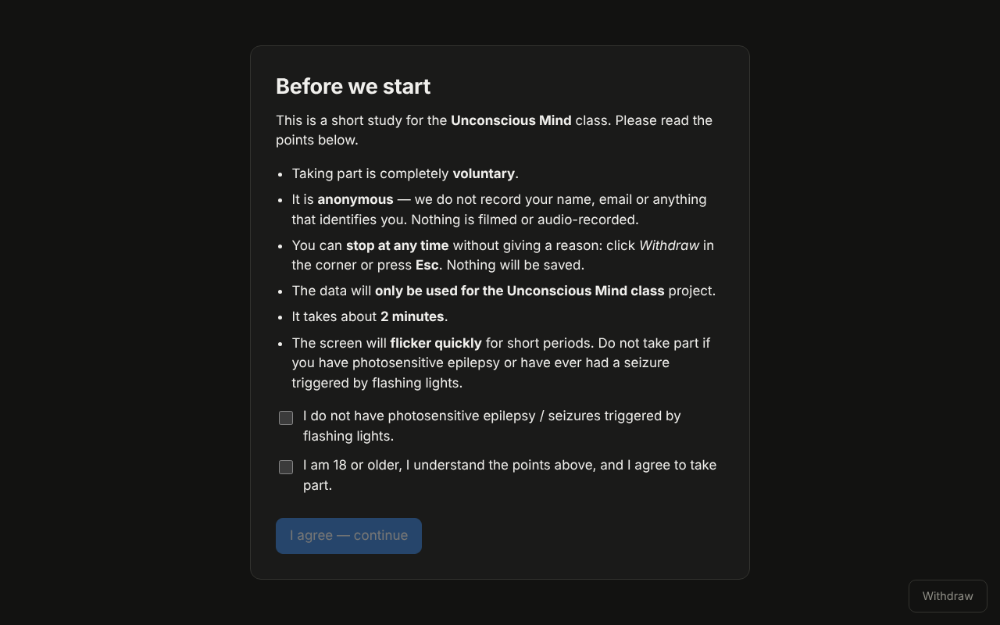 |
| **2. A few questions** — age, gender, nationality, year. | 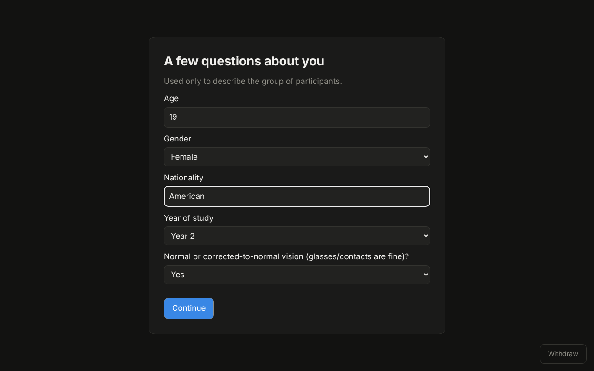 |
| **3. Instructions** — what will happen. | 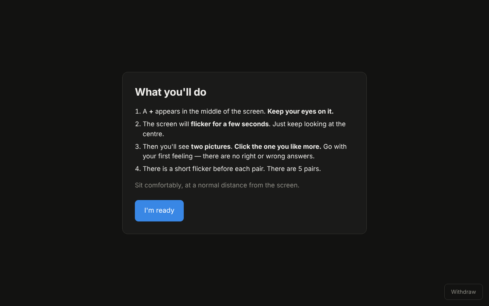 |
| **4. The flicker** — a **+** in the middle, then fast flickering. They just look at the middle. | 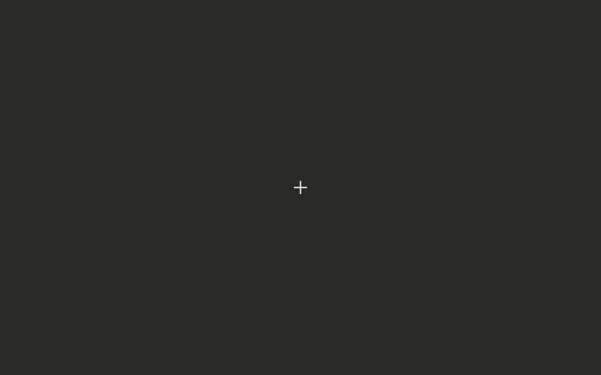 |
| **5. Choices** — click the picture they like more. 5 times. | 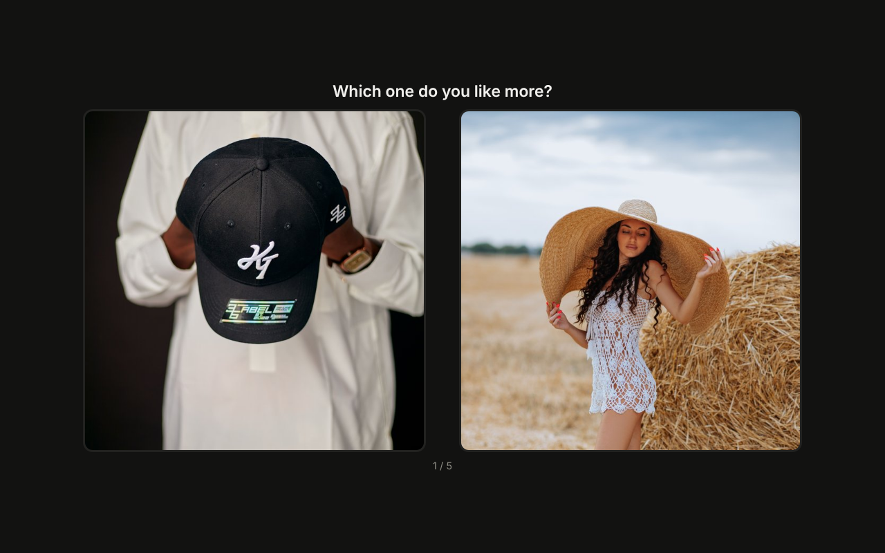 |
| **6. Did you notice anything?** — a few short questions. | 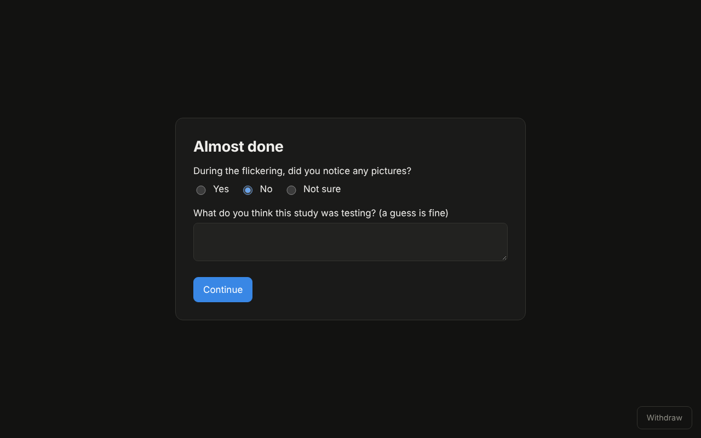 |
| **7. Which one was hidden?** — 4 quick guesses. | 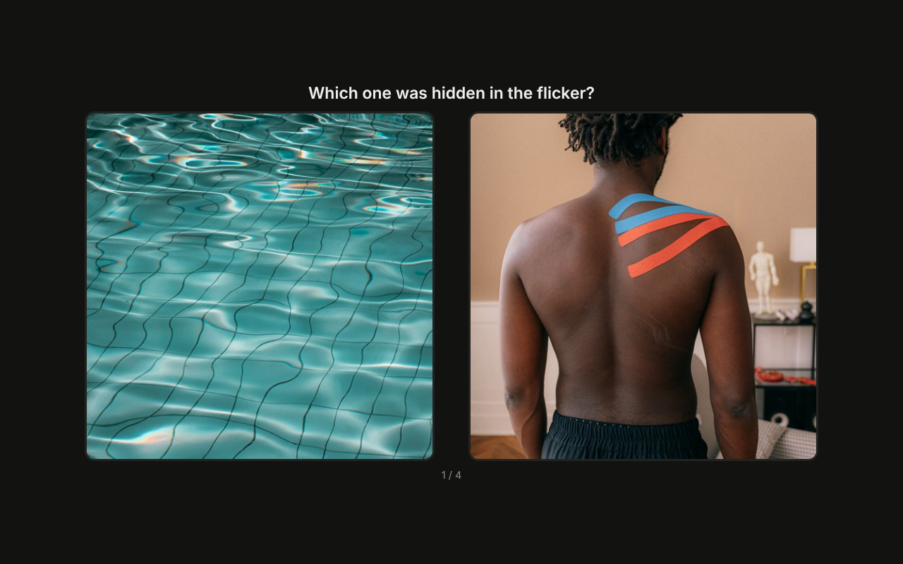 |
| **8. Thank you** — explains what the study was about. | 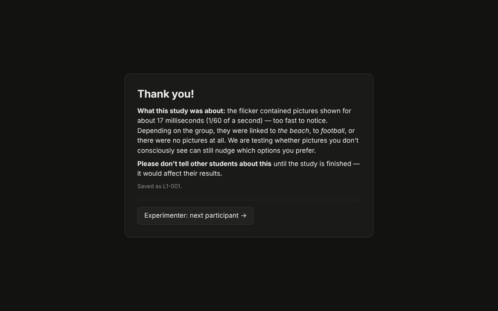 |

**7.2** At the end, a file like **`result_L1-001.csv`** is saved in your **Downloads** folder automatically. 🎉

**7.3** Take the laptop back and click **Experimenter: next participant →**. Repeat for the next person.

> ⚠️ **Don't press `Esc` while a participant is doing it!** Esc (or leaving full screen) means *"I want to stop"* —
> the session ends and **nothing is saved**. That is on purpose: participants are allowed to quit any time.
>
> 🤐 Don't tell participants about the hidden pictures before they start. The Thank-you screen explains it at the end.

---

## Step 8 — Save and send the results

The results are saved in **two places**, so nothing gets lost:

1. 📄 One small file per person in your **Downloads** folder (`result_L1-001.csv`, `result_L1-002.csv`, …)
2. 💾 A backup inside Chrome on this laptop.

**At the end of the day:**

1. On the setup screen, click **Download all results (CSV)**. You get one file with everyone from this laptop (`all_results_L1_….csv`).

   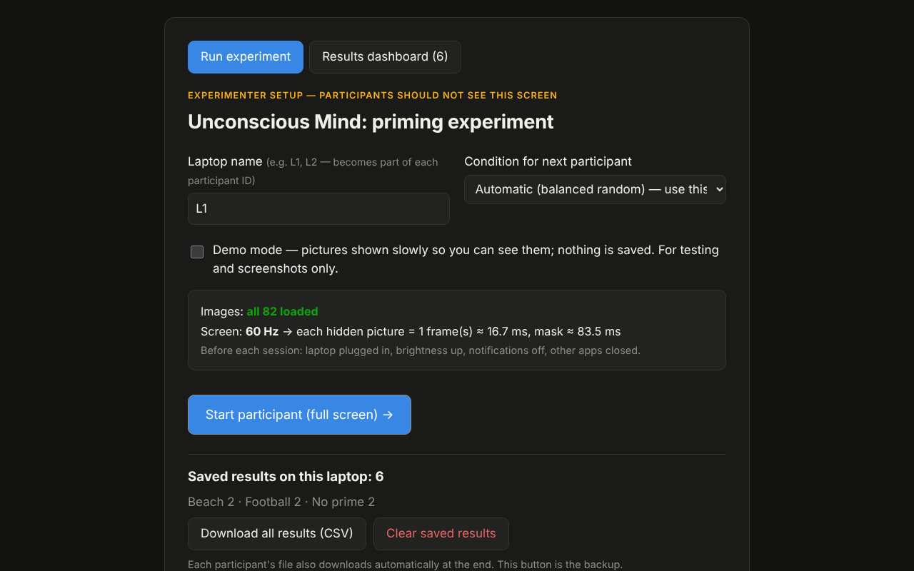

2. Send that file to the group leader (WhatsApp, email, Google Drive — anything works).

> 🛑 **Never click _Clear saved results_** unless the group leader says the files have arrived safely.

---

## Step 9 — Look at the results dashboard

On the setup screen, click the **Results dashboard** tab. It shows everyone saved on **this** laptop straight away:
which group chose what, whether the hypothesis is supported, charts, and a ready-written paragraph for the report.

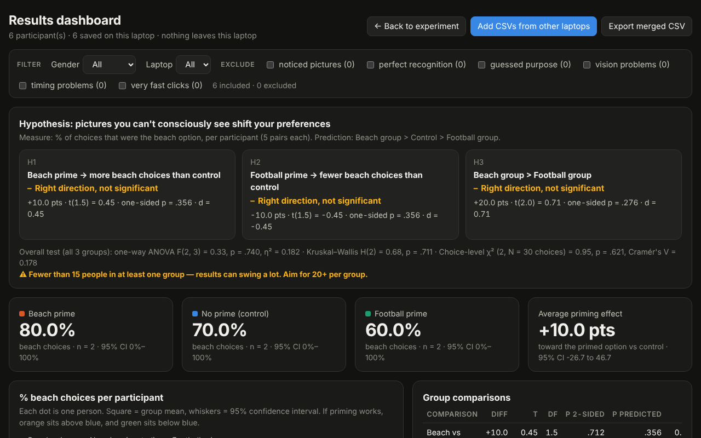

*(Picture from a test run with 6 pretend clicks — your numbers will be different.)*

**To see everyone from all laptops together:** click **Add CSVs from other laptops**, and pick the files the others sent you.
It's OK to add the same person twice — the app removes duplicates. ✅

---

## Step 10 — Get the newest version later

If the group leader says *"I updated the app"*, open the Terminal (Step 2) and paste:

```bash
cd ~/Desktop/unconscious-mind-experiment-temp
```

```bash
git pull
```

Then reload the app in Chrome (**⌘ Command + R**). Your saved results stay safe. ✅

---

## 🆘 Something went wrong?

| What you see | What to do |
|---|---|
| `git: command not found` | Do Step 3 again. |
| `fatal: destination path … already exists` | You already downloaded it! Skip to Step 5. |
| `zsh: no such file or directory` / `cd: no such file` | The folder isn't on your Desktop. Do Step 4 again. |
| The app is stuck on **"Loading…"** | You opened it outside its folder, or not in Chrome. Open `index.html` **from inside** the folder, with **Chrome** (Step 5). |
| It opened in **Safari** | Right-click `index.html` → **Open With → Google Chrome**. |
| Red text: **"Missing files: …"** | Some pictures didn't download. Delete the folder and do Step 4 again. |
| Red text: **"Please use Google Chrome"** | You are in another browser. See Step 5. |
| Chrome asks **"Allow downloads?"** | Click **Allow**. |
| No CSV in Downloads | Click **Download all results (CSV)** on the setup screen — the backup is still there. |
| `git pull` says *"Your local changes would be overwritten"* | You changed a file by accident. Paste `git checkout -- .` then `git pull` again. (Your results are safe — they live in Chrome, not in the folder.) |
| Anything else | Take a screenshot (**⌘ Command + Shift + 4**, then drag over the screen) and send it to the group leader. |

---

## 📁 What's in the folder

| File / folder | What it is | Do I touch it? |
|---|---|---|
| [`index.html`](index.html) | **The app.** Open this in Chrome. | Open it ✅ |
| [`config.js`](config.js) | Settings: timings, which pictures, which pairs. | Only the group leader ✏️ |
| [`app.js`](app.js) | The code of the experiment and the dashboard. | No 🚫 |
| [`lib/`](lib/) | React, built in, so no internet is needed. | No 🚫 |
| [`stimuli/`](stimuli/) | The small pictures the app really uses ([beach](stimuli/beach/), [football](stimuli/football/), [choices](stimuli/choices/), [masks](stimuli/masks/)). | No 🚫 |
| [`images/`](images/) | The original big photos we downloaded. | No 🚫 |
| [`tools/prepare_stimuli.py`](tools/prepare_stimuli.py) | Makes `stimuli/` from `images/`. | No 🚫 |
| [`docs/screenshots/`](docs/screenshots/) | The pictures in this guide. | No 🚫 |

**Useful links**

- 🌐 This project on GitHub: <https://github.com/Thevaultboy11/unconscious-mind-experiment-temp>
- 🌐 Google Chrome: <https://www.google.com/chrome/>
- 🌐 Git for Mac: <https://git-scm.com/download/mac>
- 🖼️ Where the photos came from: <https://unsplash.com> and <https://www.pexels.com> (free to use)

---

## 🔬 For the group leader: how the experiment works

### What the participant sees

| Step | What happens | Time |
|---|---|---|
| Consent | Bullet points (voluntary, anonymous, can leave anytime with *Withdraw* or Esc, class use only, flicker warning) + 2 checkboxes | — |
| Demographics | Age, gender, nationality, year of study, vision | — |
| Instructions | Look at the +, then pick the picture you like more | — |
| Main flicker | + for 2 s, then 48 flashes: 24 pictures × 2, each **17 ms** (1 screen frame) followed by an **83 ms** scrambled mask | ~7 s |
| 5 choices | Before each pair: + then 6 more flashes (~0.6 s), then "Which one do you like more?" | ~30 s |
| Awareness check | "Did you notice any pictures?", "What did you see?", "What was this study testing?" | — |
| Recognition test | 4 pairs (one beach prime, one football prime): "which was hidden in the flicker?" | — |
| Debrief | Explains the study, asks them not to tell other students | — |

Leaving full screen or pressing Esc at any point = withdrawn, nothing is saved.

### Design

* **Independent variable:** prime condition — A beach, B football, C no prime (identical flicker and masks,
  gray frames instead of pictures). Assigned automatically in shuffled blocks of 3 per laptop, so groups stay balanced.
* **Dependent variable:** number of beach choices out of 5 (`beach_choices`). `primed_choices` = choices that
  match the participant's prime.
* **Prediction:** beach group > no-prime group > football group in `beach_choices`.
* **Subliminality check:** `noticed_images`, `saw_description` and `recog_correct` (out of 4; chance = 2).
  If the A/B groups score clearly above 2, the pictures were not fully subliminal.
* **Suggested analysis:** one-way ANOVA (or Kruskal–Wallis) on `beach_choices` across the 3 groups, or a
  chi-square on beach vs football choices × condition. Report `prime_ms_mean` and `dropped_frames` to show the
  timing was correct.

### Why 17 ms and not 1 ms?

A laptop screen redraws 60 times a second, so nothing can be shown for less than one frame (16.7 ms).
We use the shortest possible: **one frame**. What makes a picture subliminal is the **backward mask** right after it:
masked pictures shown for up to ~50 ms are typically not consciously seen but are still processed. The app counts screen refreshes
(not milliseconds), adapts to 120 Hz screens, and logs the real duration of every flash.

### Stimuli

| Folder | Contents |
|---|---|
| `images/` | Original downloads (full size, untouched) |
| `stimuli/beach`, `stimuli/football` | 19 photos + 5 generated patterns each, cropped to 512×512 |
| `stimuli/choices` | The 20 choice pictures, 640×640 |
| `stimuli/masks` | 24 scrambled mosaics made from both prime sets (same masks for every group) |

Left out: `beach/20.jpg` (watermelon — same object as a choice option) and `football/12.jpg`
(watermelon — a beach item). `choices/10.jpg` was renamed to `10a.jpg`.

Choice pairs (matched by category, edit in `config.js`):
flip-flops vs football boot · sun hat vs cap · coconut vs sports bottle · ice cream vs burger ·
tropical beach vs ball on pitch. Five spare pairs are kept in `sparePairs` in `config.js`.

If you change photos, run `python3 tools/prepare_stimuli.py` (needs `pip install pillow numpy`).

### Results dashboard

Same page: on the setup screen click the **Results dashboard** tab. It shows every participant saved on this
laptop straight away. To combine laptops, click **Add CSVs from other laptops** (or drag the files in) —
`result_*.csv` and `all_results_*.csv` together is fine, duplicates are removed. Nothing leaves the laptop.

It shows:
* **Hypothesis verdicts** — H1 beach > control, H2 football < control, H3 beach > football, with Welch t-tests,
  effect sizes, one-way ANOVA, Kruskal–Wallis and a choice-level χ².
* % beach choices per participant (every dot = one person, mean ± 95% CI), the distribution of scores, and the
  average priming effect in percentage points.
* Which pairs moved (per-pair chart and table).
* **Was it subliminal?** — "noticed pictures" by group, recognition test vs chance, a robustness table that
  re-runs the tests without people who might have been aware, and everyone's written answers (close guesses tagged).
* Behaviour — effect by trial position, decision times, left/right bias.
* Participants — gender (with a balance check), age, nationality, year, effect by gender.
* Data quality — refresh rates, real flash durations, dropped frames, flagged participants.
* A sortable table of every participant, filters (gender, laptop) and exclusion toggles that update everything.
* An auto-written **Findings paragraph** for the lab report, and a merged CSV export.

### Files

* `index.html` — open this: runs participants and has the results dashboard
* `app.js` — the experiment and the dashboard (React via `lib/`, no build step)
* `config.js` — timings, picture lists, pairs: **the only file you should need to edit**
* `tools/prepare_stimuli.py` — makes `stimuli/` from `images/`

### Data columns (one row per participant)

`participant_id, laptop, condition, started_at, finished_at, duration_s, age, gender, nationality, study_year,
vision_ok`, then for each pair `pairN_<category>` (beach/football), `pairN_rt_ms`, `pairN_order`,
`pairN_beach_side`, then `n_pairs, beach_choices, football_choices, primed_choices, noticed_images, saw_description,
purpose_guess, recog_beach_picks, recog_correct, recog_trials, refresh_hz, prime_frames, prime_ms_target,
prime_ms_mean, prime_ms_min, prime_ms_max, mask_ms_mean, dropped_frames, total_flashes, screen, browser`.
